# 🛡️ Awesome Business Continuity Management (BCM)

  

  
  
  
  
  
  

---

## 📖 Overview & SEO Summary

**Business Continuity Management (BCM)** is the strategic, organizational, and technological discipline that guarantees mission-critical operations persist through disruptions, crises, and disasters. Modern BCM integrates **Business Impact Analysis (BIA)**, **Disaster Recovery (DR)**, **Crisis Management & Mass Alerting**, **Operational Resilience**, and continuous validation through tabletop exercises and live simulations.

With tightening global regulations—including the **EU Digital Operational Resilience Act (DORA)**, **NIS2 Directive**, **SEC Cybersecurity Disclosure Rules**, and **ISO 22301:2019** certification standards—organizations must transform static continuity binders into automated, live dependency graphs and tested recovery workflows.

This curated repository tracks the leading **SaaS platforms**, industry benchmarks, starting price points, free tier evaluations, and **open-source tools** engineered to keep businesses continuously operational.

---

## 📑 Table of Contents

- [📊 Sector Overview & Market Dynamics](#-sector-overview--market-dynamics)
- [🏢 SaaS & Hosted Enterprise BCM Platforms](#-saas--hosted-enterprise-bcm-platforms)
- [💻 Open-Source Resilience & Continuity Projects](#-open-source-resilience--continuity-projects)
- [📐 Core BCM Metrics & Terminology](#-core-bcm-metrics--terminology)
- [🤝 How to Contribute](#-how-to-contribute)
- [📈 Star History](#-star-history)
- [💖 Support & Sponsoring](#-support--sponsoring)
- [📜 Disclaimer](#-disclaimer)

---

## 📊 Sector Overview & Market Dynamics

The global **Business Continuity Management (BCM) and Operational Resilience software market** is estimated at **$1.20 Billion in 2024–2025** and is projected to expand to **$2.85 Billion by 2030**, growing at a compound annual growth rate (**CAGR**) of **14.5%**. This growth is heavily accelerated by mandatory systemic risk compliance (EU DORA, UK PRA/FCA Operational Resilience mandates, APRA CPS 230), increased cloud multi-region dependency, and heightened ransomware frequency.

### Market Fragmentation vs. Concentration
The BCM sector is **moderately fragmented**:
- **Enterprise Core (Top Tier):** Well-funded governance and integrated risk management (IRM) platforms like **ServiceNow**, **Archer**, **Riskonnect (Castellan/Assurance)**, and **Fusion Risk Management** hold strong positions among Global 2000 enterprises requiring complex, cross-departmental dependency modeling and CMDB alignment.
- **No Absolute "Winner-Take-All":** Rather than consolidating around a single monolithic player, the market sustains numerous high-performing specialized vendors:
  - *Mid-market & SMB Continuity Suites:* **Preparis (Mitratech)** and **Noggin**.
  - *Vertical Banking & Financial Services:* **Quantivate (Ncontracts)** specializing in FFIEC and NCUA compliance.
  - *Critical Event Notification & Crisis Telemetry:* **Everbridge (BC in the Cloud)**.
- **Open-Source Emergence:** While enterprise BCM software has historically been proprietary due to stringent audit and regulatory liability requirements, high-utility open-source projects are rapidly emerging for underlying disaster recovery, scenario automation, situation command, and BIA assessment.

---

## 🏢 SaaS & Hosted Enterprise BCM Platforms

The table below catalogs premier SaaS BCM and operational resilience platforms, ranked in descending order by company scale (**Market Valuation / Annual Revenue**), with concrete starting-tier prices and specific trial allowances.

| 🏷️ Platform / Vendor | 📈 Company Size (Valuation / Revenue) | ⚙️ Key Capabilities & Resilience Focus | 💰 Pricing (Specific Starting Tier) | 🎁 Free Tier / Free Trial Limits |
| :--- | :--- | :--- | :--- | :--- |
| [**ServiceNow BCM**](https://www.servicenow.com/products/business-continuity-management.html) | **~$185B Valuation** *(~$10.0B Annual Revenue; NYSE: NOW)* | Enterprise BCM built natively on the Now Platform; automated Business Impact Analysis (BIA), crisis workflows, CMDB configuration dependency mapping, and Everbridge critical event notification integration. | **~$100 / user / month** for full fulfiller seats; enterprise minimum annual commitments start at **~$40,000 – $50,000 / year** (Lite stakeholder licenses available at ~$15–$25/user/month). | **Permanent Personal Developer Instance (PDI)** sandbox (indefinite access; refreshed every 10 days of active use); **14-day guided enterprise sandbox trial** available upon sales scoping. |
| [**Noggin**](https://www.noggin.io/) *(Motorola Solutions)* | **~$75B Parent Valuation** *(~$10.0B Parent Revenue; Unit ~$20M)* | Integrated operational resilience workspace, crisis information logging, ISO 22301 aligned planning, interactive hazard maps, and real-time exercise testing. | **~A$75,000 / year** (~$49,000 USD/year) on enterprise/G-Cloud schedule; entry-level operational resilience setups start at **~$10,000 – $12,000 / year**. | **14-day guided trial sandbox** with full template access, BCM workflow builder, and pre-built crisis playbooks upon sales consultation. |
| [**BC in the Cloud**](https://www.everbridge.com/) *(Everbridge)* | **~$1.8B Valuation** *(~$450M Annual Revenue; Thoma Bravo)* | Cloud-native BCM and disaster recovery planning integrated directly with Everbridge 360 Critical Event Management (CEM); automated RTO vs. RTA comparison and incident alerts. | **~$7,957 / year** (~$663/month) baseline SMB contract tier for core continuity and alerting; enterprise resilience suites start at **~$30,000 – $50,000 / year**. | **14-day guided proof-of-concept (POC) sandbox trial** covering BIA modules, emergency contact trees, and recovery runbooks upon sales qualification. |
| [**Preparis**](https://www.preparis.com/) *(Mitratech / Agility)* | **~$1.5B Parent Valuation** *(~$45M Unit Revenue; TA / OTPP)* | Cloud continuity suite for mid-market and SMB enterprises; bi-directional emergency alerting across SMS/voice, incident checklists, and physical workplace recovery. | **~$8,000 / year** (~$667/month) starting tier for core continuity and bi-directional alert portal; multi-location facilities scale to **~$25,000 / year**. | **14-day free trial** of the Preparis emergency messaging and plan portal for up to **50 test contacts** with complete SMS/voice broadcast testing. |
| [**Castellan**](https://www.riskonnect.com/) *(Riskonnect)* | **~$1.1B Valuation** *(~$180M Annual Revenue; Clearlake)* | Unified BCM platform (merger of Avalution & ClearView Continuity); automated BIA scoring, emergency mass communication, and out-of-the-box regulatory compliance frameworks. | **~£30,000 / year** (~$38,000 USD/year) base G-Cloud listing tier per instance; observed 3-year government agency contracts range from **£33,000 to £138,000**. | **30-day customized enterprise pilot / POC sandbox** featuring full BIA matrix, plan generation, and tabletop exercise simulation for qualified teams. |
| [**Assurance Software**](https://www.riskonnect.com/) *(Riskonnect)* | **~$1.1B Valuation** *(~$180M Annual Revenue; Clearlake)* | Established enterprise continuity and IT disaster recovery software (formerly SunGard BCM); multi-site crisis response coordination and audit defense. | **~$25,000 – $35,000 / year** baseline tier for core BIA and plan development; enterprise multi-entity deployments scale to **~$60,000+ / year**. | **30-day proof-of-concept sandbox trial** with sample ISO 22301 BIA templates and recovery runbook builder upon sales review. |
| [**Archer IRM**](https://www.archerirm.com/) *(Cinven)* | **~$1.0B+ Valuation** *(~$220M Annual Revenue; Cinven)* | Enterprise Integrated Risk Management (IRM) and operational resiliency suite; continuous IT disaster recovery mapping, scenario disruption testing, and quantified risk scoring. | **~$49.87 / user / month** entry catalog reseller tier via CDW; core enterprise resilience module packages start at **~$20,000 – $35,000 / year**. | **30-day proof-of-concept (POC) sandbox trial** for enterprise risk teams with full access to resilience modeling and BIA workflows. |
| [**MetricStream ConnectedGRC**](https://www.metricstream.com/) | **~$500M Valuation** *(~$110M Annual Revenue; Clearlake)* | AI-powered BCM and operational resilience module; automated criticality scoring, RTO/RPO calculation, multi-channel crisis alerting across 25+ channels, and vendor risk scoring. | **~$75,000 / year** starting enterprise tier (named user licenses starting at **~$3,000 / user / year** on standard 3-year agreements; 1-year terms incur 15–25% premium). | **14-day structured interactive sandbox demo** environment with pre-loaded BIA frameworks and risk registers post-scoping call. |
| [**Fusion Risk Management**](https://www.fusionrm.com/) | **~$450M Valuation** *(~$60M Annual Revenue; Vista / Great Hill)* | Enterprise Resilience Decision System built on Salesforce; live data-driven recovery, interactive dependency visualization across people, systems, facilities, and third parties. | **~$30,000 / year** AppExchange baseline entry tier; average observed enterprise contract is **~$93,000 / year** (range: $7K/yr single-use to $149K+/yr). | **30-day interactive sandbox trial** with sample business process dependency maps and scenario playbooks upon sales qualification. |
| [**Quantivate**](https://quantivate.com/) *(Ncontracts)* | **~$250M Valuation** *(~$30M Annual Revenue; Gryphon)* | Specialized GRC and BCM platform purpose-built for financial institutions (banks, credit unions); FFIEC/NCUA compliance, automated BIA, and incident management. | **~$10,000 – $15,000 / year** starting tier for community financial institutions ($250M–$500M asset tiers); multi-module GRC scales to **~$35,000+ / year**. | **14-day structured interactive demo / trial sandbox** pre-configured with financial institution BIA and incident runbook templates. |

---

## 💻 Open-Source Resilience & Continuity Projects

The following open-source repositories provide foundational tooling for disaster recovery automation, incident orchestration, situation management, backup verification, and business impact analysis. 

The list is sorted in **descending order by GitHub star count**, with verified badges linking directly to each repository's stargazers:

1. 🐘 **[cloudnative-pg/cloudnative-pg](https://github.com/cloudnative-pg/cloudnative-pg)**   
   The leading Kubernetes Operator for PostgreSQL, engineered for zero-data-loss business continuity; provides automated failover, multi-region disaster recovery replication, and continuous WAL archiving.

2. ⏱️ **[OneUptime/oneuptime](https://github.com/OneUptime/oneuptime)**   
   Complete open-source observability, uptime monitoring, public and private status pages, on-call alert orchestration, and incident crisis coordination platform for site reliability.

3. 🚨 **[Netflix/dispatch](https://github.com/Netflix/dispatch)**   
   Netflix's open-source crisis and incident management orchestration platform; automates incident triage, recovery workflows, stakeholder communication trees, and post-incident retrospectives.

4. 🐝 **[TheHive-Project/TheHive](https://github.com/TheHive-Project/TheHive)**   
   Scalable cybersecurity and operational incident response management platform featuring real-time collaborative workspace, dynamic task assignment, and actionable response runbooks.

5. 📦 **[EnterpriseDB/barman](https://github.com/EnterpriseDB/barman)**   
   Enterprise backup and disaster recovery manager for PostgreSQL; supports remote logical and physical backups, zero-data-loss (RPO=0) recovery architectures, and point-in-time recovery (PITR).

6. 🌐 **[alibaba/Appactive](https://github.com/alibaba/Appactive)**   
   Alibaba's standard middleware dedicated to building multi-site active/active disaster recovery and multi-datacenter business continuity architectures with automated traffic re-routing.

7. 🏰 **[mehdi-arfaoui/Stronghold](https://github.com/mehdi-arfaoui/Stronghold)**   
   Open-source disaster recovery posture scanner for AWS environments (read-only, zero telemetry); exposes the "reality gap" between claimed protection and proven recoverability and validates runbook liveness.

8. 🏥 **[nocomp/scribe](https://github.com/nocomp/scribe)**   
   Open-source hospital crisis management platform (AGPL) built for healthcare crisis coordination; features an integrated scenario injector for simulated crisis exercises and JSON-replayable scenarios.

9. 🤝 **[sahana/eden](https://github.com/sahana/eden)**   
   Rapid Application Development framework for humanitarian disaster response, organizational crisis logistics, volunteer coordination, and emergency supply chain management.

10. 📝 **[f-eld-ch/sitrep](https://github.com/f-eld-ch/sitrep)**   
    Open-source real-time situation management software for crisis command staffs (AGPL); central journal for incoming/outgoing incident logging, centralized triage, and digital crisis mapping.

11. 🛡️ **[matank001/asclepius](https://github.com/matank001/asclepius)**   
    Automated backup integrity and recoverability validation engine; parses restored files directly to test document, database, and archive readability to guarantee actual RPO compliance.

12. 📊 **[paolocarner/simplified-bia](https://github.com/paolocarner/simplified-bia)**   
    Simplified Business Impact Analysis (BIA) template and evaluation tooling for SMBs to systematically quantify operational dependencies, financial impact tiers, and downtime tolerance.

13. 📋 **[capetron/business-continuity-plan-template](https://github.com/capetron/business-continuity-plan-template)**   
    Comprehensive business continuity plan (BCP) repository featuring BIA worksheets, critical function matrices, recovery strategy outlines, communication trees, and audit schedules.

14. 🧪 **[fstelte/Business-Impact-Assessment](https://github.com/fstelte/Business-Impact-Assessment)**   
    Python/Flask web application for conducting BIAs locally or organization-wide with SQLite/MariaDB persistence; assesses process criticality and outage thresholds.

15. 💥 **[Mullassery/PyBlastRadius](https://github.com/Mullassery/PyBlastRadius)**   
    Open-source blast radius analysis and criticality scoring SDK with a Rust core; parses Terraform dependency trees and dbt pipelines to surface systemic operational failure vectors.

---

## 📐 Core BCM Metrics & Terminology

| Metric / Concept | Full Title | Definition & Operational Resilience Importance |
| :--- | :--- | :--- |
| **BIA** | Business Impact Analysis | Systematic process to determine and evaluate the potential effects of an interruption to critical business operations. |
| **RTO** | Recovery Time Objective | The maximum acceptable duration of time that a system or business function can remain down before intolerable consequences occur. |
| **RPO** | Recovery Point Objective | The maximum acceptable amount of data loss measured in time (e.g., up to 5 minutes of transactional data). |
| **BCP** | Business Continuity Plan | Documented procedures and action plans guiding the organization to respond, recover, resume, and restore operations. |
| **DRP** | Disaster Recovery Plan | The technical subset of BCP focused specifically on restoring IT infrastructure, data centers, networks, and applications. |
| **ISO 22301** | Security and Resilience — BCM Systems | The international standard specifying requirements for a management system to protect against and reduce the likelihood of disruptions. |

---

## 🤝 How to Contribute

Contributions are warmly welcomed! Help keep this ecosystem comprehensive and accurate:

1. 🍴 **Fork the Repository** on GitHub.
2. 🌿 **Create a Feature Branch** (`git checkout -b feature/add-bcm-tool`).
3. ✏️ **Add / Update Entries**:
   - Ensure SaaS entries include verified starting tier pricing, company size, and specific free trial terms.
   - Ensure open-source projects include a valid Shields.io star badge linking to `/stargazers`.
4. 📝 **Commit Your Changes** (`git commit -m "feat: add NewTool BCM platform"`).
5. 🚀 **Push to the Branch** (`git push origin feature/add-bcm-tool`).
6. 📬 **Open a Pull Request** with a brief summary of the submission.

---

## 📈 Star History

---

## 💖 Support & Sponsoring

Thank you for visiting and supporting **Awesome Business Continuity Management**! If you find this curated list valuable for your organization, resilience planning, or research, please consider supporting the project:

- ⭐ **Star this repository** to help others discover it.
- 🍴 **Fork and contribute** by submitting PRs for new SaaS tools, open-source frameworks, or compliance updates.
- 📢 **Share with your network** of risk officers, SREs, and business continuity professionals.
- ☕ **Buy a coffee / Sponsor**: Support ongoing maintenance via the [GitHub Sponsor Dashboard](https://github.com/sponsors/ihhandutta2007).

---

## 📜 Disclaimer

- This curated list is maintained for educational and informational purposes. Product specifications, subscription prices, and corporate valuations change periodically; always verify current terms directly with vendor representatives.
- Platforms handling regulated enterprise business data, patient records, or financial transactions must adhere to statutory requirements (**ISO 22301**, **EU DORA**, **NIST SP 800-34**, **HIPAA**, **SOC 2 Type II**).
- Open-source tools listed are subject to their respective software licenses (AGPLv3, Apache-2.0, MIT, etc.).

---

  Maintained with ❤️ for business continuity managers, resilience officers, SREs, and crisis coordinators worldwide.

